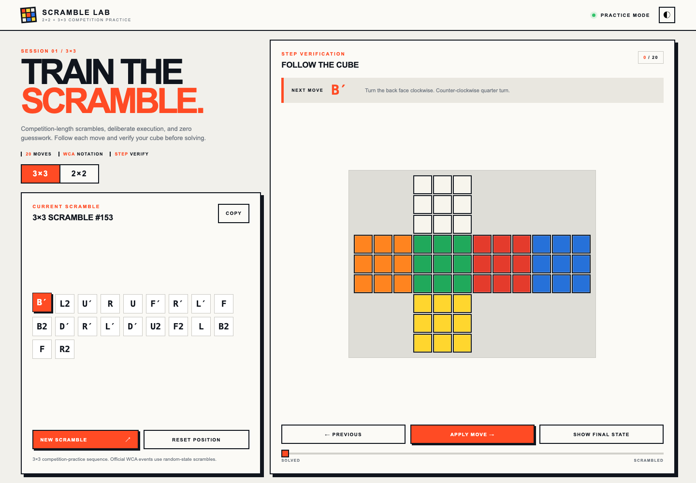

# Rubic's Cube Scramble Trainer

A focused browser-based trainer for practicing 2×2 and 3×3 cube scrambles.

## Features

- Switch between 2×2 and 3×3 practice modes.
- Generate competition-length practice scrambles with standard WCA notation.
- Follow every move on a color-accurate cube net.
- Move forward or backward one step at a time, or jump with the progress slider.
- Show the completed scramble state instantly for verification.
- Copy a scramble, reset the cube, or generate a new sequence in one click.
- Use the responsive interface on desktop or mobile without a backend.

> **Note:** Rubic's Cube Scramble Trainer generates constrained practice sequences. Official WCA
> competitions use approved random-state scramble software such as TNoodle.

## Preview



## Use This Repository

### Open it directly

Clone the repository and open `docs/index.html` in a browser:

```sh
git clone https://github.com/akhil0309/scramble_trainer.git
cd scramble_trainer
open docs/index.html
```

On Windows or Linux, open `docs/index.html` from your file manager instead of
using the `open` command.

### Run a local web server

For a normal local URL, serve the checked-in browser build:

```sh
python3 -m http.server 8000 --directory docs
```

Then visit [http://localhost:8000](http://localhost:8000).

### Publish a fork with GitHub Pages

1. Fork this repository.
2. Open the fork's **Settings → Pages**.
3. Choose **Deploy from a branch**.
4. Select the `main` branch and `/docs` folder.
5. Save and wait for GitHub to provide the Pages URL.

### Regenerate the build

Node.js 20 or newer is required only when regenerating build artifacts:

```sh
npm run build
```

This refreshes the GitHub Pages output in `docs/` and the Sites worker package
in `dist/`. The app itself has no runtime dependencies.

## Project Files

- `index.html`, `styles.css`, `app.js` — application source.
- `docs/` — final browser-ready output committed for GitHub Pages.
- `scripts/build-sites.mjs` — reproducible build script.
- `dist/` — generated Sites worker output, excluded from Git.
